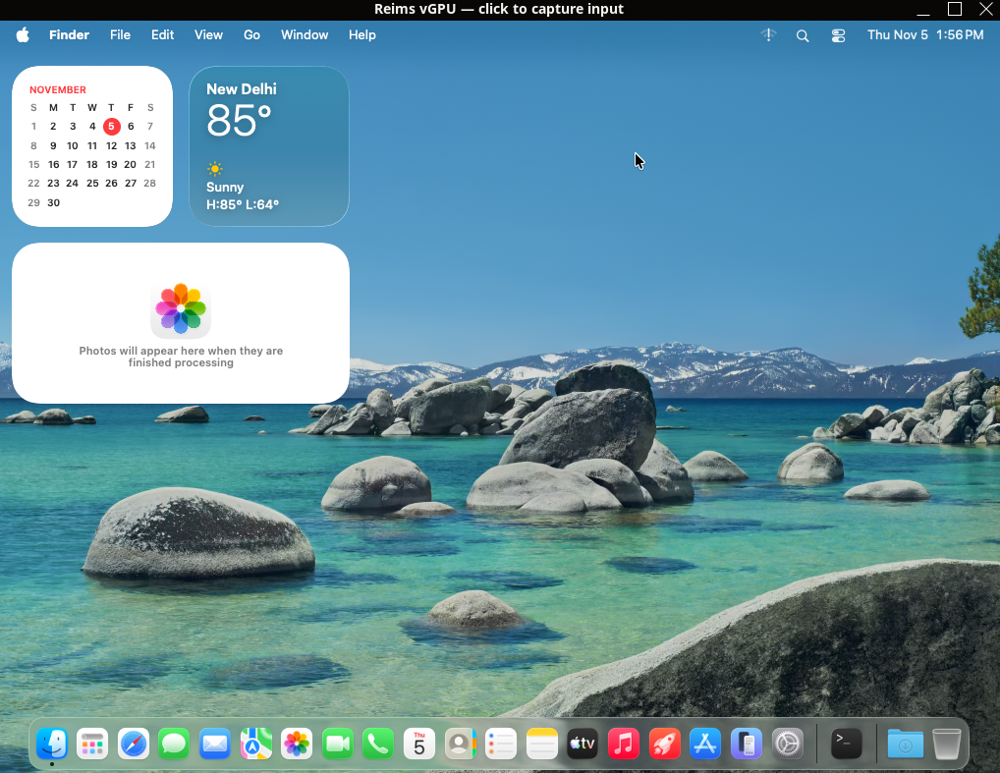

# tmac

[](https://github.com/RealNarcissus/tmac/actions/workflows/ci.yml)
[](https://github.com/RealNarcissus/tmac/releases)
[](LICENSE)

**A terminal-first, MCP-controllable control plane for self-hosted macOS VMs on Linux.**

tmac is an independent Linux x86_64 port of the control model behind
[terminal-mac](https://github.com/govijr/terminal-mac). It uses QEMU/KVM instead of Apple's
Virtualization.framework, drives the guest through QMP, and exposes a small MCP tool surface for
AI agents and test harnesses. No guest helper, Accessibility grant, or virtio-fs mailbox is required.

> **Status: experimental alpha.** It is a laboratory tool for developers who already have a macOS VM,
> not a supported macOS distribution, a Mac replacement, or a free macOS CI service.



## Two VM lanes

Both lanes use the same QMP/MCP control plane; the display path and maturity differ.

| Lane | Guest | Display / control | Best for | Status |
|---|---|---|---|---|
| **Terminal lane** | macOS 12.7.6 Monterey | Software framebuffer + `host/tmac.py view` / MCP | Headless automation, terminal/SSH work, long-running agent jobs, legacy tooling | **Stable; recommended default** |
| **GPU lane** | macOS 26.6.2 Tahoe | Reims vGPU + GUI window; `reims-ctl view` and `tmac attach` also work | Modern macOS, Metal, GUI app experiments | **Experimental; 1024×768; host-VRAM limits** |

The terminal lane is not obsolete. It is the better choice when stability and terminal-first control
matter. The GPU lane is the modern-macOS path, but it is not a drop-in replacement for every workload.

## What works

- **Monterey terminal lane** under QEMU/KVM with a software framebuffer and the native `tmac` MCP server.
- **Tahoe GPU lane** under QEMU/KVM and [Reims vGPU](https://github.com/steelbrain/reims-vgpu),
  reporting **Metal 2** and rendering the full desktop.
- **Terminal-first viewer** for running guests: `reims-ctl view` with half-block/Kitty/iTerm output.
- **External-VM MCP** through `tmac attach`: screenshot, click, move, drag, scroll, type, key, status.
- **Managed QEMU macOS VMs** through `host/tmac.py`: lifecycle, snapshots, VNC, audio, WebDAV, and
  the Monterey terminal lane.
- **No guest helper** on the critical path; QMP provides frames and input even at login/installer
  screens.

The tested Tahoe configuration is **1024×768** on a 4 GiB NVIDIA GTX 1650 Ti. Higher modes render but
can exhaust host Vulkan memory under load. See [docs/gpu.md](docs/gpu.md).

## Quick start: attach an existing VM

Use this for a Reims-created Tahoe GPU VM (or any running QEMU VM with a QMP socket).

Requirements: Linux x86_64, Python 3.10+, and an existing macOS VM that is already running.

```sh
git clone https://github.com/RealNarcissus/tmac.git
cd tmac
python3 -m venv .venv
. .venv/bin/activate
python -m pip install -e '.[mcp]'  # distribution name: tmac-linux

# Register the running VM. This does not start or stop it.
tmac attach tahoe \
  --qmp-socket "$HOME/.local/share/reims-ctl/vms/tahoe/qmp.sock" \
  --width 1024 --height 768 \
  --ssh-port 2224 \
  --guest-user "$USER"

tmac status tahoe
tmac action tahoe screenshot --output /tmp/tahoe.png
tmac mcp tahoe
```

To use the built release wheel instead of an editable checkout:

```sh
python -m pip install \
  'https://github.com/RealNarcissus/tmac/releases/download/v0.2.0/tmac_linux-0.2.0-py3-none-any.whl'
```

The GitHub release is source/wheel only; it contains no Apple software or VM images.

The external-VM commands refuse `start`/`stop`; manage the VM with its owner (`reims-ctl`, QEMU, or
libvirt). The SSH options are only needed for Unicode paste and are not stored with a password.

### MCP client configuration

After `tmac attach`, register the stdio server with an MCP client such as Claude Desktop:

```json
{
  "mcpServers": {
    "macos-vm": {
      "command": "tmac",
      "args": ["mcp", "tahoe"]
    }
  }
}
```

The tool surface is:

| Tool | Purpose |
|---|---|
| `screenshot` | Capture the guest screen; coordinates are pixels in the returned image. |
| `click` | Click, double-click, triple-click, or right-click. |
| `move` | Move the pointer. |
| `drag` | Press, drag, and release. |
| `scroll` | Scroll at a point. |
| `type` | Type ASCII through QMP; Unicode uses guest clipboard when SSH is configured. |
| `key` | Press a key or chord such as `cmd+space`. |
| `status` | Report VM state and screen size. |

## Tahoe GPU lane (experimental)

The verified recipe uses the separately installed `reims-ctl`, the Reims QEMU build, an offline
macOS installer supplied by the user, and `apple-gfx-pci`. The complete runbook, including the
required `METAL_ERROR_MODE=5` guest preference, SSH setup, cursor patch, and VRAM limits, is in
[docs/tahoe.md](docs/tahoe.md).

No macOS installer, IPSW, VM disk, OpenCore image, Apple SMC OSK, or Apple binary is included in
this repository. You supply the installer and any OSK required by your own managed-QEMU workflow,
and you are responsible for Apple's license terms. See [LEGAL.md](LEGAL.md).

## Monterey terminal lane (recommended default)

The original Linux port and MCP proof used macOS 12.7.6 with a software framebuffer. It remains the
stable terminal-first lane in `host/tmac.py` and the `gui-proof` VM home:

```sh
export TMAC_HOME="$PWD/work/main/tmac-home"
python3 host/tmac.py status gui-proof
python3 host/tmac.py start gui-proof
python3 host/tmac.py view gui-proof
python3 host/tmac.py mcp gui-proof
```

See [docs/architecture.md](docs/architecture.md), [docs/porting.md](docs/porting.md), and
[docs/FINAL-REPORT.md](docs/FINAL-REPORT.md) for the original investigation. The terminal lane is
independent of the external-VM/MCP path above.

## Why this design

- **QMP instead of a guest helper.** `screendump` and `input-send-event` work from firmware through
  macOS login, without ScreenCaptureKit or Accessibility permissions.
- **The VM is owned by its hypervisor.** `attach` records the QMP socket and screen metadata but
  never claims lifecycle ownership.
- **The terminal is a first-class surface.** The viewer is useful over SSH and on headless hosts;
  Reims' GPU window is available when full color and responsiveness matter.
- **Evidence over claims.** Research documents distinguish observed, inferred, and unknown results;
  screenshots, logs, and reproduced commands live under `evidence/`.

## Limitations

- **x86_64 only.** Apple-silicon VM behavior and arm64-only tooling are out of scope.
- **Experimental macOS versions.** Tahoe requires Reims; the AppleParavirtGPU path is not stable on
  the preserved Monterey guest.
- **No app build/test CI yet.** The MCP server is GUI computer use; it has not been demonstrated
  compiling or testing a real Xcode project.
- **Finite host VRAM.** Reims can exhaust a 4 GiB GPU at higher resolutions; 1024×768 is the tested
  stable mode.
- **US-ASCII QMP typing.** Unicode depends on guest SSH and the clipboard helper.
- **Not a security sandbox.** The MCP server can click and type anywhere in the guest. Run a
  disposable VM and review tool calls.

## Repository layout

```text
host/tmac.py             QEMU/QMP control plane, viewer, and MCP server
host/qmp_broker.py       concurrent QMP client broker for managed VMs
scripts/                 OpenCore/AMD helpers and the Reims cursor patch
tests/                   unit tests; no QEMU or macOS required
docs/                    architecture, porting notes, runbooks, evidence ledger
evidence/                captured screenshots, logs, and validation artifacts
```

## Development

```sh
python3 -m venv .venv
. .venv/bin/activate
python -m pip install -e '.[mcp,share]'
python -m unittest discover -s tests -v
python -m compileall -q host scripts
```

CI runs the same unit tests and byte-compilation on Python 3.10, 3.12, and 3.14.

## Security and legal

- Read [SECURITY.md](SECURITY.md) before exposing a QMP socket or guest SSH port.
- Read [LEGAL.md](LEGAL.md) before publishing a fork, hosting a service, or distributing anything
  built from a macOS guest. Apple's macOS license generally restricts virtualization to Apple-branded
  hardware; this project does not grant you a macOS license.
- The repository is **GPL-2.0-or-later**. The Reims cursor patch is a GPL-covered modification.
  See [LICENSE](LICENSE) and [THIRD_PARTY_NOTICES.md](THIRD_PARTY_NOTICES.md).

## Contributing

Issues and focused pull requests are welcome. Read [CONTRIBUTING.md](CONTRIBUTING.md) and
[CODE_OF_CONDUCT.md](CODE_OF_CONDUCT.md). Never include credentials, SSH keys, Apple installers,
VM disks, or personal screenshots in an issue.

## Credits

- [terminal-mac](https://github.com/govijr/terminal-mac) — MIT; original design and MCP tool model.
- [reims-vgpu](https://github.com/steelbrain/reims-vgpu) and
  [metal2vulkan](https://github.com/steelbrain/metal2vulkan) — virtual GPU and runtime.
- [OSX-KVM](https://github.com/kholia/OSX-KVM) and
  [AMD_Vanilla](https://github.com/AMD-OSX/AMD_Vanilla) — boot and kernel-patch foundations.
- QEMU, OpenCore, OVMF, Pillow, WsgiDAV, and Cheroot — see their upstream licenses.
- The preserved Monterey research artifacts are documented in [docs/FINAL-REPORT.md](docs/FINAL-REPORT.md).

*Not affiliated with Apple Inc.*
