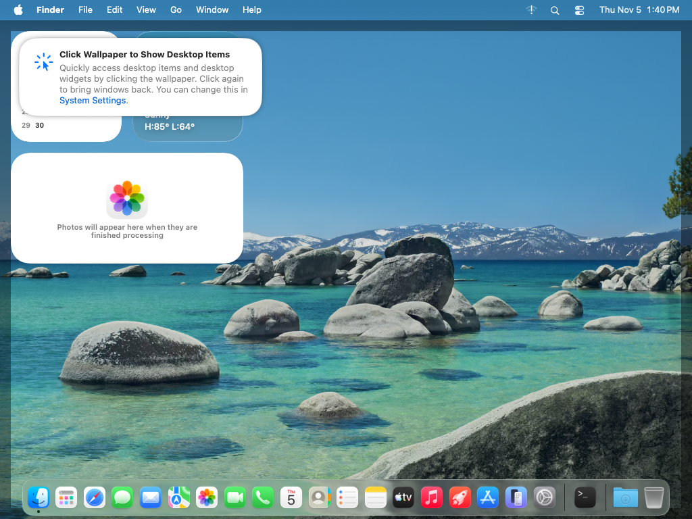
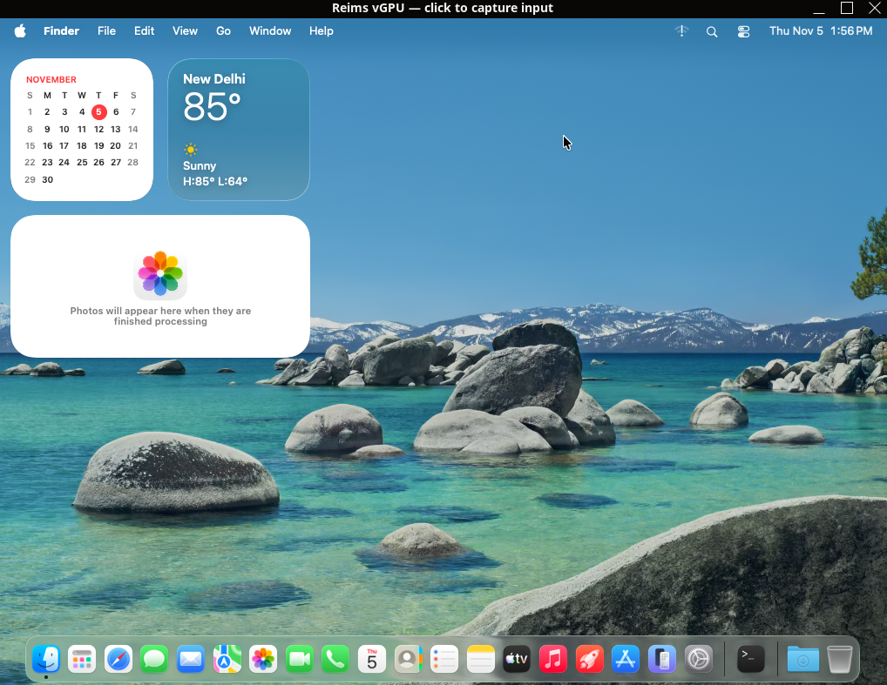

# macOS Tahoe 26.6.2 on Linux — verified runbook

Status: **working**, observed 2026-11-05 on the same AMD Ryzen Linux host used for the Monterey work.
This is the current target; `gui-proof` (macOS 12.7.6) is preserved as the older software-rendered
reference.

## What is running

- VM name: `tahoe`
- Guest: **macOS 26.6.2**, build **25G83**, Darwin **25.6.0** x86_64
- Host: AMD Ryzen 5 4600H, KVM, 14 GiB RAM, NVIDIA GTX 1650 Ti
- QEMU: reims-ctl's QEMU 11.1.50, `q35` + OpenCore + reims-vgpu
- Guest resources: 8 vCPU, 8 GiB RAM, 1024×768, SATA disk, 58 GB qcow2
- Network: QEMU user networking; SSH forwarded to `127.0.0.1:2224`
- Login: the guest account you create during Setup; no password is stored in this repository
- Host SSH key: `~/.ssh/tmac_guest`
- GPU: **Reims vGPU**, reported as **Metal Support: Metal 2**
- `METAL_ERROR_MODE=5` is set in `/Library/Preferences/.GlobalPreferences`; reims' x86-64 Tahoe
  instructions require it for the icon service and WindowServer. Verified with
  `defaults read` after reboot.

The VM lives outside this checkout:

```text
~/.local/share/reims-ctl/vms/tahoe/
├── disk.qcow2
├── opencore.qcow2
├── OVMF_CODE.fd
├── OVMF_VARS.fd
├── vm.toml
└── qemu.pid / qmp.sock / logs/
```

## Run it

Use the installed reims-ctl binary. It is at `~/.cargo/bin/reims-ctl` on this host and was not on
the non-login shell's PATH during the investigation.

```sh
# State / config
~/.cargo/bin/reims-ctl show tahoe

# Start the Reims vGPU window
~/.cargo/bin/reims-ctl start tahoe

# Terminal-first view: real TTY required; Ctrl-] disconnects and leaves the VM running
~/.cargo/bin/reims-ctl view tahoe --fps 15 --protocol blocks
# Kitty/Ghostty can use the default protocol:
~/.cargo/bin/reims-ctl view tahoe --fps 15

# Stop
~/.cargo/bin/reims-ctl stop tahoe
```

`reims-ctl view` is the closest equivalent of the terminal-mac viewer for this VM: it draws the
guest screen in the host terminal and forwards the terminal keyboard, mouse and pasted text. It
exits with `reims-ctl: view draws in a terminal: run it in one` when stdout is a pipe, so use a real
terminal (or a pty allocator).

### MCP and the host control plane

Register the already-running Reims VM with `tmac attach`; it records the QMP socket and screen size
without taking lifecycle ownership:

```sh
python3 -m pip install -e '.[mcp]'   # from the repository checkout
tmac attach tahoe   --qmp-socket "$HOME/.local/share/reims-ctl/vms/tahoe/qmp.sock"   --width 1024 --height 768 --ssh-port 2224 --guest-user "$USER"
tmac status tahoe
tmac mcp tahoe
```

`tmac start tahoe` and `tmac stop tahoe` refuse to operate on this record; use
`reims-ctl start|stop tahoe`. The MCP screenshot, click, move, drag, scroll, type, key and status
tools are exercised against this path. `--guest-user` is only needed for Unicode clipboard paste;
no password is stored.

The GTK/SDL Reims window is the preferred surface for full-resolution work. Click inside it once if
it says input is not captured. `Ctrl+Alt+Super` releases host input capture.

## SSH

```sh
ssh -i ~/.ssh/tmac_guest -p 2224 tmac@127.0.0.1
```

The public key in `~/.ssh/tmac_guest.pub` was appended to the guest's
`~/.ssh/authorized_keys`; password login also works.

The ordinary `sudo systemsetup -setremotelogin on` route fails here with:

```text
systemsetup: Turning Remote Login on or off requires Full Disk Access privileges.
```

That is a Full Disk Access restriction on Terminal, not a missing sshd. Remote Login is present in
this image but not shown as a toggle in System Settings > Sharing on this install. The working
enablement was:

```sh
sudo /bin/launchctl load -w /System/Library/LaunchDaemons/ssh.plist
```

Run that inside a guest Terminal with the admin account. The SSH listener was then reachable on
host port 2224. `systemsetup` needs Full Disk Access and is not required.

## Install / Setup Assistant notes

The VM was created from reims-ctl's **offline** macOS Tahoe installer:

```text
~/.local/share/reims-ctl/installers/macOS-Tahoe-26.6.2-25G83-offline-installer.img
```

A reproducible create command with the same shape is:

```sh
~/.cargo/bin/reims-ctl create tahoe \
  --macos 26.6.2 --offline \
  --cpus 8 --memory 8G \
  --resolution 1024x768 \
  --ssh-port 2224 \
  --start
```

The recorded `vm.toml` is more authoritative than a reconstructed command and is included at
`evidence/host/tahoe/show.txt` and `evidence/host/tahoe/qemu-command.txt`.

Installation:

1. Boot the installer, open Disk Utility, erase the target as **APFS**, and reinstall macOS.
2. Complete Setup Assistant. Choose **Set up as new**, skip Apple Account (Sign In Later), decline
   Location Services, skip Analytics/Siri, and choose **Not Now** for FileVault.
3. Create an admin account of your choice. Use a unique test password; credentials are not stored in this repository.
4. Set Metal's error mode, then reboot:

   ```sh
   sudo defaults write /Library/Preferences/.GlobalPreferences METAL_ERROR_MODE -int 5
   sudo reboot
   ```

   Reims requires this on x86-64 Tahoe; without it the icon service can crash and a fresh desktop
   can stay on the wallpaper with no menu bar/Dock. The current VM reads **5**.

QMP mouse clicks selected radio rows and menu items, but repeatedly failed to activate the
Setup Assistant **Continue** button. Real host input worked: with the Reims window focused,
`ydotool key 28` (Return) activated the default button. Manual UI completion is also valid. A host
`ydotool` daemon (`ydotoold --socket-path=/tmp/.ydotool_socket`) was used for this.

Before `METAL_ERROR_MODE=5` was set, Setup Assistant completion once showed only the wallpaper
with no menu bar or Dock. After setting the required Metal error mode and rebooting, the login
screen and a fully rendered desktop appeared. If the wallpaper-only state recurs, verify the
preference is readable as **5**, then reboot; do not change the GPU first.

## GPU evidence

`system_profiler SPDisplaysDataType` inside the guest reports:

```text
Reims vGPU:
  Chipset Model: Reims vGPU
  Type: GPU
  Vendor: Apple (0x106b)
  Device ID: 0xeeee
  Revision ID: 0x0000
  Metal Support: Metal 2
  Displays:
    Reims vGPU:
      Resolution: 1024 x 768 (XGA - eXtended Graphics Array)
      Main Display: Yes
      Connection Type: Internal
```

`ioreg` shows `AppleParavirtGPUControl` and `AppleParavirtGPU` loaded. The live QMP screenshot
shows the Tahoe wallpaper, menu bar, widgets, Dock, Terminal and System Settings rendered through
the Apple-gfx scanout. The terminal viewer drew 2,520 half-block cells from the same running VM.

Artifacts:

- `evidence/host/tahoe/system-profiler.txt`
- `evidence/host/tahoe/guest.txt`
- `evidence/host/tahoe/desktop.jpg` — live MCP screenshot of the 1024×768 Tahoe desktop
- `evidence/host/tahoe/desktop.png` — QMP PNG capture of the same VM
- `evidence/host/tahoe/reims-view.raw` — raw `reims-ctl view` terminal capture
- `evidence/host/tahoe/viewer.txt`
- `evidence/host/tahoe/reims-window.png` — host screenshot of the Reims window after login
- `evidence/host/tahoe/reims-crash-note.txt` — first-run Reims VRAM failure and restart
- `evidence/host/tahoe/show.txt`
- `evidence/host/tahoe/qemu-command.txt`
- `evidence/host/tahoe/mcp/tahoe-mcp-smoke.json`
- `evidence/host/tahoe/mcp/tahoe-mcp-screenshot.jpg`



Host screenshot of the same VM in the Reims window:



## Stability limit: host VRAM

The first long Tahoe session, before `METAL_ERROR_MODE=5` was set, eventually stopped with Reims'
Vulkan runtime refusing a draw
(`out of Device memory`) after a series of `overrun write` messages. The host GPU has 4096 MiB
total; shortly after the restart, `nvidia-smi` showed QEMU/Reims at 1152 MiB and Herdr at
1217 MiB. This was triggered under heavy use (Safari/App Store plus repeated QMP screenshot
polling), not at idle. `reims-ctl start tahoe` booted the same disk back to login and the desktop;
the account and GPU setup survived.

If it recurs, close the heavy host GPU clients, reduce the guest resolution with
`reims-ctl set tahoe --resolution 1600x900` (next start), and avoid continuous QMP screendumps
while the guest is rendering. The verified evidence above is from the successful sessions; do not
describe Reims as crash-free under arbitrary host GPU load.

## Why this satisfies the original goal

The upstream `terminal-mac` is arm64/Apple-framework-only. This Linux implementation instead uses
QEMU/KVM + OpenCore for the guest and reims-vgpu for the virtual display/GPU. The result is a real
macOS Tahoe desktop on Linux, reachable both in a host window and in the host terminal, with no
Apple hardware and no guest helper.
